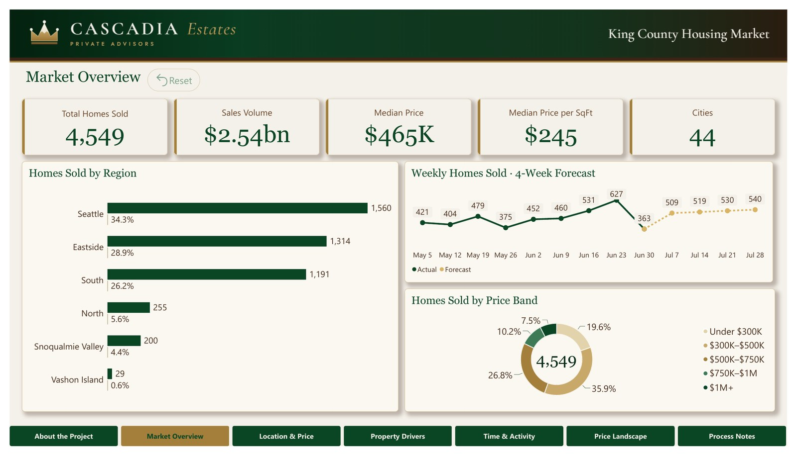
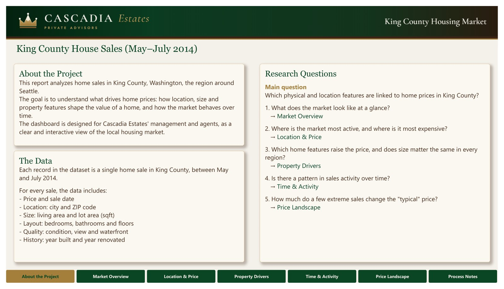
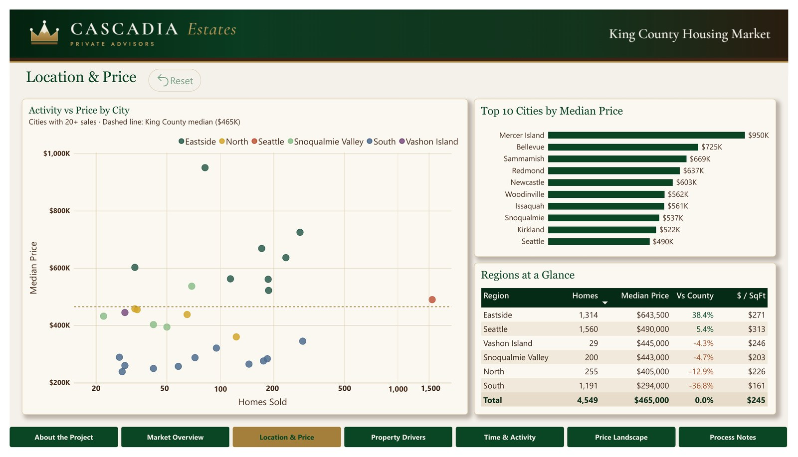
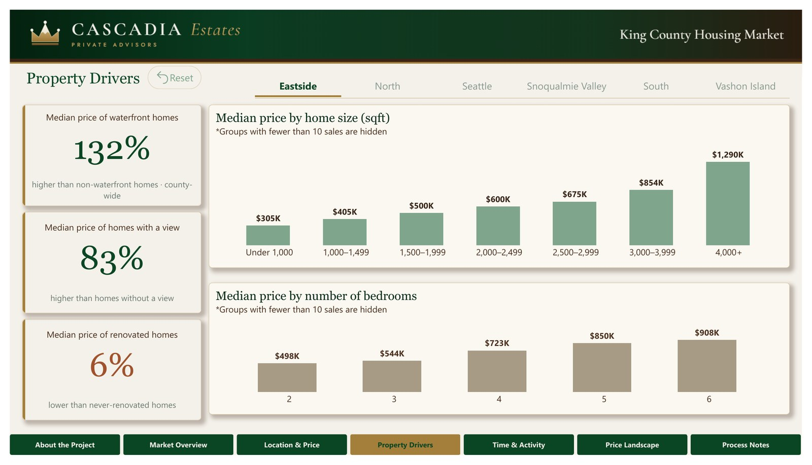
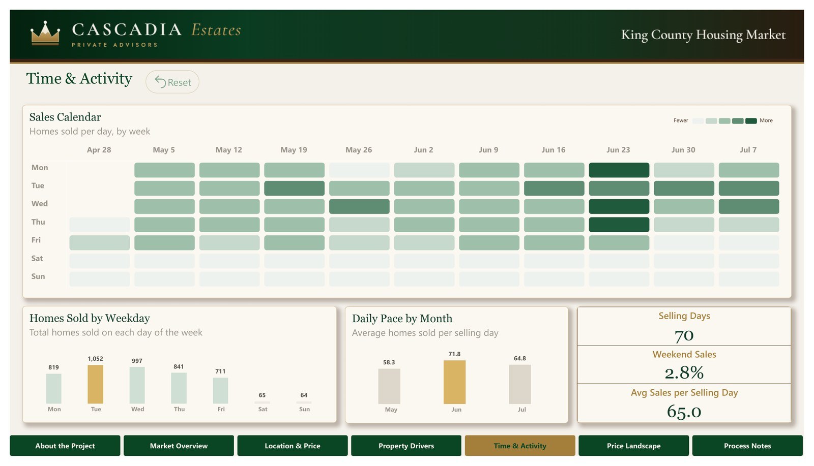
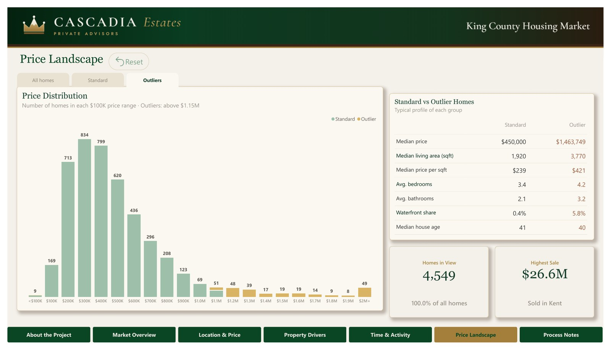
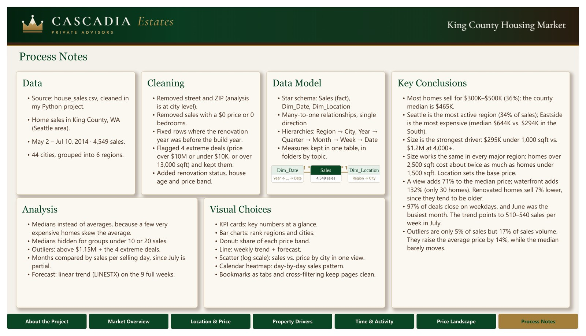

# Cascadia Estates: King County housing market report

- **Tools:** Power BI Desktop · Power Query · DAX
- **Data:** 4,549 home sales in King County, Washington, May–July 2014
- **Audience:** the owner of Cascadia Estates, a real-estate brokerage
- **Files:** [`Cascadia_Estates.pbix`](Cascadia_Estates.pbix) (the interactive report, opens in Power BI Desktop) · [`Cascadia_Estates_Report.pdf`](Cascadia_Estates_Report.pdf) (all pages as PDF)

## Business question
Where, when and what kind of homes sell in King County, and which deals fall outside the normal price range?

## Technical highlights
- **Data model:** star schema with a `Sales` fact table and `Dim_Date` and `Dim_Location` dimensions; Location and Date hierarchies
- **DAX:** IQR outlier rule (Q3 + 1.5 × IQR), `TOPN` rankings, an SVG heatmap measure, and a linear-trend forecast built from two measures
- **Interactivity:** cross-filtering between visuals, a region slicer, bookmark tabs, drill-down, and a custom tooltip page
- **Design:** a custom theme with a consistent palette, logo strip and page navigator on every page

## The report

### 1. About the Project
Topic, data and research questions.

### 2. Market Overview
KPIs, homes by region with Region → City drill-down, weekly sales with a 4-week forecast, and price bands.

### 3. Location & Price
Cities by sales volume and median price on a log scale against the county median, top 10 cities and a regions table.

### 4. Property Drivers
Waterfront, view and renovation premiums, price by size band and by number of bedrooms, filtered by region.

### 5. Time & Activity
A weekday × week sales calendar, sales by weekday and the daily sales pace by month.

### 6. Price Landscape
Price distribution with bookmark tabs for all homes, standard deals and outliers, plus a standard vs. outlier comparison.

### 7. Process Notes
Data, cleaning, data model, analysis, visual choices and key conclusions.

## Design decisions
- Visuals cross-filter each other instead of filling each page with slicers.
- July is a partial month, so months are compared by average sales per selling day.
- Partial first and last weeks are excluded from the weekly chart.
- Medians are used for city prices, with a minimum number of sales per city, so a few luxury deals do not distort the picture.
